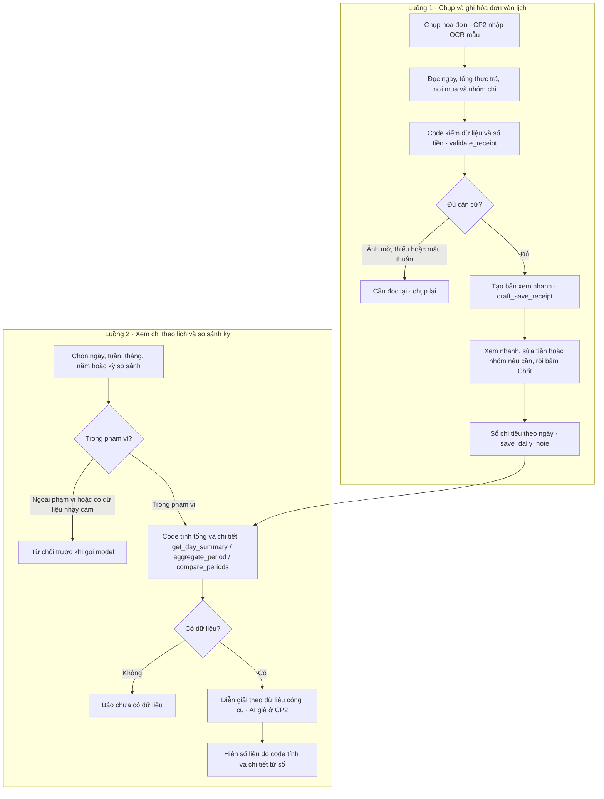

# AI SPEC — Nhật ký chi tiêu từ ảnh · Nhóm 404ERROR · Phòng H210 · Zone 5

Theo danh sách phân phòng, nhóm hiển thị là **404 ERROR**, đội **#5**.

> Mốc nộp: §7 chốt chuẩn "đạt" tại **CP2 19:30 Thứ Sáu 27/11** · §0–§7 nộp **CP3 10:00 Thứ Bảy 28/11** · đủ §0–§10 **CP4 14:30 Thứ Bảy 28/11** · §10 changelog ghi tiếp đến **23:59 Thứ Bảy 28/11**.
> Đầu mỗi mục ghi bước guide (`02-guide.md` trong repo đề) chỉ cách điền. Mỗi mục ngắn, có số và nguồn; chi tiết để ở file được trỏ tới. Xoá dòng hướng dẫn trong ngoặc vuông khi điền xong.

Track E · Tài chính · Nhật ký chi tiêu cá nhân

**Lịch sử chọn track.** Nhóm chọn Track D (Thương mại điện tử) ban đầu rồi cập nhật CP1 sang Track E (Tài chính cá nhân). Ở CP2, nhóm thêm bước xem nhanh và bấm Chốt trước khi lưu khoản chi vào lịch. [Lát cắt ở bản CP1 đã sửa](README.md#cp1)

## §0. Hiện tại việc này diễn ra thế nào *(guide 1.1)*

- Luồng cần kiểm bằng phỏng vấn: người dùng nhận hóa đơn sau khi mua, rồi ghi số tiền vào sổ, bảng tính hoặc app để xem tổng chi sau này. Giả thuyết là họ tiếp tục ghi theo cách này vì muốn giữ một chỗ tra cứu, nhưng dễ bỏ qua khoản phải nhập lại.
- Xác minh qua một lần gần nhất: dùng nguồn nào, thao tác nào hay bị bỏ qua và mất bao lâu. Chỉ hỏi về hành vi, thời gian và số bước.

## §1. Người dùng & bằng chứng *(guide 1.1, 1.2)*

- Người dùng chính: người có hóa đơn khi mua sắm hoặc ăn uống và muốn biết đã tiêu gì trong ngày và tháng.
- Việc muốn hoàn thành: ghi khoản chi ngay sau khi mua và mở lịch để xem lại.
- Vấn đề dự kiến: Người muốn theo dõi chi tiêu hằng ngày phải nhập lại thông tin từ từng hóa đơn, nên dễ bỏ sót khoản chi và mất thời gian khi xem lại đã tiêu vào đâu.
- Bằng chứng: 8/500 review nêu ma sát khi ghi hoặc muốn nhập tự động, 5/500 nêu khó tra cứu và 12/500 nêu sai lệch khi ghi sổ. Các nhóm này định hướng thiết kế và kiểm thử. [Tổng hợp bằng chứng](evidence/summary.md).

## §2. Impact & quyết định chọn *(guide 1.3)*

**Kịch bản thử, tất cả số ở bảng là tự ước tính.** Giả sử 30 người dùng chi tiêu từ hóa đơn thử mỗi hướng trong một tháng. Tần suất và thời gian là giả định khác nhau cho từng tác vụ. Các số review không dùng để suy ra quy mô này.

| Hướng | Bao nhiêu người gặp | Số lần/người/tháng | Mỗi lần tốn gì | Impact/tháng | Làm kịp? | Chọn? |
|---|---|---|---|---|---|---|
| Tạo khoản chi từ ảnh sau một lần chốt | 30 người thử | 12 hóa đơn | 35 giây có thể tiết kiệm mỗi lần (giả sử từ 60 còn 25 giây thao tác) | **210 phút** | Dự kiến có thể demo từ ảnh mẫu | Chọn làm lát cắt |
| Tra khoản chi trên lịch | 30 người thử | 8 lượt tra | 20 giây có thể tiết kiệm mỗi lượt | 80 phút | Có thể dùng các khoản đã lưu | Giữ làm đầu ra |
| Tổng hợp chi tiêu tháng | 30 người thử | 1 lượt tổng hợp | 4 phút có thể tiết kiệm mỗi lượt | 120 phút | Có thể tính từ các khoản đã lưu | Giữ ở mức tổng hợp |

- **Impact / tháng của lát cắt:** 30 × 12 × 35 giây = 210 phút/tháng trong kịch bản giả định. Đo lại bằng cùng một hóa đơn ở hai cách ghi, tính từ khi bắt đầu đến khi xem được khoản đã lưu. Nếu ảnh phải chụp lại, tính cả thời gian thao tác thêm.
- Chọn luồng chụp hóa đơn vì nó giải quyết ngay thao tác nhập lại. Lịch và tổng hợp tháng dùng dữ liệu từ luồng này. Phỏng vấn sẽ giúp kiểm tra ưu tiên giữa ba hướng.

## §3. Giải pháp tương tự *(guide 2.1)*
- **Đối thủ đã làm gì:** [Sổ Thu Chi MISA](https://play.google.com/store/apps/details?hl=vi&id=vn.com.misa.sothuchi) công bố tính năng chụp hóa đơn và phân loại tự động; [Money Lover](https://play.google.com/store/apps/details?hl=vi&gl=vn&id=com.bookmark.money) có luồng ghi chi tiêu và quét/OCR hóa đơn được người dùng nhắc tới trong review.
- **Một điều đáng học:** Đưa ảnh hóa đơn làm đầu vào chính để giảm ma sát ghi chép (8/500 review nêu phiền khi nhập tay hoặc muốn nhập tự động) và cho phép sửa nhanh khi OCR đọc nhầm (*“fix OCR errors easily”* — Money Lover · 163).
- **Một điều đáng né:** Tự động lưu khi đọc sai số tiền hoặc ghi thiếu/trùng gây lệch tổng (12/500 review ở hai app nêu lỗi ghi thiếu, trùng hoặc sai tổng), và thiếu chế độ xem chi tiết từng ngày (*“không hiện được từng ngày cụ thể”* — Money Lover · 147).
- **Mình khác gì (theo pain 1.2):** Tập trung đúng một lát cắt: chụp một hóa đơn → xem nhanh số thực trả và ngày chi → bấm Chốt một lần (dùng mã lượt chụp chống cộng trùng), ảnh mờ đẩy sang **Cần đọc lại**, và chạm ngày trên lịch mở ngay từng khoản kèm ảnh hóa đơn gốc.

## §4. Thiết kế *(guide 2.2, 3.2)*

- **Lát cắt MỘT CÂU** (1 người dùng · 1 việc · 1 quyết định AI · 1 kết quả). Khi người ghi chi tiêu cá nhân chụp một hóa đơn, AI chọn nhóm chi dựa trên nội dung hóa đơn để họ có một khoản chi trên lịch sau khi bấm Chốt.

**Hình dạng: workflow cố định.** Các bước đọc ảnh, kiểm số tiền, xem nhanh, chốt và tổng hợp diễn ra theo thứ tự. Ở CP2, văn bản OCR giả đi qua đúng luồng CLI. Đọc ảnh và màn hình lịch dành cho bản tiếp theo.

| Công cụ CP2 | Input | Output | Tác động |
|---|---|---|---|
| `parse_receipt_text`, `validate_receipt` | OCR mẫu, ngày chụp nếu cần | Ngày, tổng thực trả, nơi mua, nhóm và trường thiếu | Chỉ đọc |
| `draft_save_receipt` | Dữ liệu đã kiểm và OCR mẫu | Bản xem nhanh trong phiên | Chỉ giữ trong phiên |
| `save_daily_note` | Bản đã được người dùng chốt | Bản ghi, trạng thái trùng và tổng ngày | Ghi SQLite cục bộ ở CLI; eval dùng sổ tạm |
| `get_day_summary`, `aggregate_period`, `compare_periods` | Ngày hoặc mốc tuần ISO, tháng, năm | Chi tiết, tổng theo nhóm và chênh lệch giữa các kỳ | Chỉ đọc |

- **G10:** nếu tổng thực trả không xác định được, báo cần đọc lại và giữ nguyên tổng. **G1:** CLI nói rõ đầu vào là OCR mẫu và model giả. **G8/G9:** nếu người dùng thấy dữ liệu đọc sai, có thể sửa tiền hoặc nhóm trước khi chốt. **G11:** hiển thị căn cứ tính tổng và nguồn ngày chụp nếu dùng ngày mặc định.
- Ở CP2, app hiển thị số liệu do code tính sau bước gọi AI giả. Phần ảnh thật, giao diện bấm lịch và nhận xét từ model thật cần kiểm ở bản tiếp theo.

- **Luồng đề xuất:** mở camera → chụp hóa đơn → app đọc và hiển thị bản xem nhanh → bấm Chốt một lần → app lưu khoản chi, cập nhật lịch và tổng tiền.
- **Dữ liệu mỗi khoản:** số thực trả (VND nguyên), ngày chi, nơi mua nếu đọc được, nhóm chi và ảnh hóa đơn. Dùng nhóm Chưa phân loại nếu thiếu căn cứ xếp nhóm. Dùng ngày chụp theo múi giờ người dùng nếu hóa đơn không ghi ngày và đánh dấu nguồn ngày.
- **Điều kiện lưu:** cần có số thực trả rõ, ngày chi và thao tác Chốt. Nếu ảnh mờ hoặc có nhiều mức tổng chưa phân biệt được, hiển thị **Cần đọc lại** và hướng dẫn chụp lại. Bản xem nhanh chưa chốt không đi vào sổ. Người dùng có thể sửa tiền hoặc nhóm nếu phát hiện đọc sai. Dùng mã lượt chụp để xử lý lại cùng ảnh mà không cộng trùng.
- **Giao diện:** mỗi ô lịch hiện tổng tiền ngày đó. Chạm ngày mở tổng và nhóm chi; **Xem thêm** mở từng khoản và ảnh hóa đơn. **+** mở camera để thêm ảnh. Màn hình tháng tính tổng, tổng theo nhóm và ngày chi nhiều nhất từ các khoản đã ghi.
- **Phạm vi demo:** mỗi ảnh hóa đơn giả lập tương ứng một khoản VND. Tính tổng ngày và tháng bằng code từ các khoản đã lưu.

## §5. Chỗ khó — 4 lớp + ≥6 kịch bản + 2 tấn công *(guide 2.3)*

| Kịch bản | Lớp | Hành vi mong muốn | Câu thử |
|---|---|---|---|
| Xem nhanh nhưng chưa Chốt | 4 | Hiện thông tin và chưa ghi vào sổ | B18 |
| Có khoản trong ngày | 1 | Hiện đúng tổng và từng khoản | B03 |
| So sánh tuần và tổng năm | 1 | Tính từ các khoản đã ghi trong kỳ tương ứng | B19, B20 |
| Ngày hoặc tháng trống | 1 | Báo chưa có dữ liệu | B06, B10 |
| Mờ số tiền | 2 | Yêu cầu chụp lại và giữ nguyên tổng | B07 |
| Thiếu ngày trên hóa đơn | 2 | Hiện nguồn ngày chụp ngay ở màn xem nhanh để người dùng kiểm trước khi Chốt | B08 |
| Tư vấn đầu tư | 3 | Từ chối | B12 |
| Xem nhật ký người khác | 3 | Từ chối | B13 |
| Nhiều mức tổng chưa xác định thực trả | 4 | Không ghi và báo đọc lại | B15 |
| Trùng mã lượt chụp | 4 | Giữ nguyên tổng ngày | B16 |
| Đầu vào có mã bảo mật | 3 | Từ chối trước khi gọi model, không lặp lại mã | B17 |
| Ép thay tổng thực trả | 4 | Từ chối, sổ không đổi | B14 |

(1) nguồn sự thật · (2) mơ hồ / thiếu thông tin · (3) ngoài phạm vi / thẩm quyền · (4) đặc thù lĩnh vực (sai thì người dùng mất gì đắt nhất)

## §6. Đường đi của trải nghiệm

- **Đủ dữ liệu:** app hiển thị ngày, số thực trả và nhóm chi. Sau khi bấm Chốt, app ghi khoản và hiện tổng ngày.
- **Thiếu hoặc mâu thuẫn:** hiện Cần đọc lại, hướng dẫn chụp lại và giữ nguyên tổng.
- **Chưa có dữ liệu:** báo rõ ngày hoặc tháng chưa có khoản ghi nhận.
- **Trùng hoặc ngoài phạm vi:** báo không ghi lại, từ chối trước khi gọi model. Luồng sửa/xóa khoản trên giao diện thuộc bản sau.

## §7. Đánh giá & chuẩn "đạt" *(guide 2.4, 4.1)*
- Data Card: `data/DATA_CARD.md`. Benchmark CP2 có **20 câu** (8 thường, 8 khó, 4 từ chối) và **4 metric**. Có 7/20 tình huống chuyển thể từ review công khai (35%); giá, ngày và sổ mẫu là giả lập.
- **Chuẩn đạt CP2 — đội trưởng đã xác nhận ngày 27/11/2026:** ít nhất **85% câu đạt**. Ca nhập đủ dữ liệu phải hiển thị đúng ngày và tổng thực trả, chỉ ghi sau khi Chốt, ca truy vấn ngày/tuần/tháng/năm có dữ liệu phải khớp số liệu, ca thiếu căn cứ không được ghi sai và **100% câu từ chối** phải từ chối đúng. Với 20 câu hiện tại, 85% tương đương **ít nhất 17/20 câu**. Giữ nguyên chuẩn sau khi nộp CP2.
- Kết quả: lượt 1 **20/20 (100%)** (thường 8/8 · khó 8/8 · từ chối 4/4, model `gpt-5.4-nano-2026-03-17`) · lượt 2 **20/20 (100%)** (thường 8/8 · khó 8/8 · từ chối 4/4, sau cải tiến ONNX `ppocrv3-viesvtr-v7`: 40 ảnh MC-OCR đạt 35/40) — run ID: `run-1@20261128-095527` / `run-2@20261128-051909` → chi tiết `eval/report.md`, hồ sơ `eval/README.md`

## §8. Chi phí khi dùng thật *(guide 4.2)*
- Persona + giá: `cost/personas.yaml` · lượt mô phỏng: `cost/simulate-1.csv` (50 phiên, `simulate-1@20261128-123906`)
- Chi phí / task thành công (chữ 100% · ảnh 87,5%): **$0.000034 + $0.000036** (`gpt-5.4-nano`) · **$0.00013 + $0.000135** (`gpt-5.4-mini`)
- Chi phí / tháng ở quy mô thật (gồm cả chữ + ảnh, `gpt-5.4-nano`): thấp (30) **$0.040 (≈ 1.007 ₫)** · cơ sở (100) **$0.132 (≈ 3.356 ₫)** · cao (300) **$0.396 (≈ 10.068 ₫)** → chi tiết `cost/cost-estimate.md`
- So với impact / người / tháng (§2): **Rất đáng làm** — tốn **≈ 34 ₫/người/tháng** (`gpt-5.4-nano`) để tiết kiệm 7–11 phút nhập hóa đơn và tra cứu lịch sử mỗi tháng.

## §9. Rủi ro & an toàn
- Dữ liệu: đã ẩn danh gì, không thu gì, không đưa gì vào model gói miễn phí:
  - Ảnh hóa đơn đọc bằng OCR cục bộ ONNX trên máy chủ của app. Chỉ khi OCR chưa ra số thực trả, ảnh (thu nhỏ ≤1600px) mới được gửi tới OpenAI `gpt-5.4-nano` qua API trả phí theo token, không qua gói chat miễn phí. Trên 40 ảnh mẫu, phần gửi đi tốn 5.415 token vào (`eval/image-check-after.jsonl`).
  - Ảnh có OTP, mật khẩu, mã PIN hoặc số thẻ (kiểm Luhn) bị chặn ngay sau OCR, không gửi model, không lưu (`receipt_has_sensitive_text`).
  - Khảo sát 24 người đã bỏ cột SĐT/liên hệ (`evidence/survey/results.csv`). Ảnh mẫu là bộ MC-OCR công khai; sổ 85 khoản là giả lập. Không thu vị trí, danh bạ hay tài khoản ngân hàng.
- AI **không được** làm gì kể cả khi người dùng yêu cầu:
  - Ghi khoản chi vào sổ khi người dùng chưa bấm **Chốt**. Model chỉ đọc ảnh và chọn nhóm trong danh sách code đưa ra; ghi sổ và cộng tổng do code làm.
  - Đoán số tiền không nhìn thấy trên ảnh, hoặc ghi khống, thao túng số liệu.
  - Xử lý OTP, mật khẩu, số thẻ; tư vấn đầu tư; đọc hay xuất sổ của người khác. Cả 4 loại bị từ chối trước khi gọi model (bộ câu thử `tu_choi` 4/4 đạt ở cả 2 lượt).
- Ai có thể bị hại nếu AI sai, và nhóm chặn thế nào:
  - **Người dùng** bị lệch sổ nếu số thực trả hoặc ngày đọc sai, bị cộng trùng nếu chụp lại cùng hóa đơn. Chặn: số model đọc phải trùng tổng OCR hoặc có trong chữ OCR của chính ảnh, lệch thì **Cần đọc lại**; ảnh mờ/lóa không gọi model; ngày sau ngày chụp → Cần đọc lại; không đọc được ngày thì dùng ngày chụp và ghi rõ "(ngày chụp)"; sửa được tiền và nhóm trước khi Chốt; mã lượt chụp chống cộng trùng (`codebase/check_flow.py` đạt cả 3 ca).
  - Rủi ro còn lại: nếu OCR cục bộ đọc nhầm một chữ số ở dòng tổng thì không có model kiểm chéo (model chỉ được gọi khi OCR chưa ra tổng), nên bản xem nhanh luôn hiện số để người dùng nhìn lại trước khi Chốt. Trên 40 ảnh mẫu chưa gặp ca nào; ca `niqeq` trước ghi là đọc lệch thực ra do nhãn sai (ảnh in 60.582) — sửa sau CP4.

## §10. Phân công & changelog
- **Cặp sản phẩm (dự kiến):** Vũ phụ trách nhận ảnh, nối model và giao diện lịch. Đức viết spec, code kiểm dữ liệu, lưu và tổng hợp ngày/tháng.
- **Cặp bằng chứng và kiểm thử (dự kiến):** Đạt dựng hóa đơn giả lập và benchmark. Kiệt phỏng vấn, tổng hợp bằng chứng và viết tiêu chí chấm.
- Dùng AI vào việc gì (2–3 dòng; chi tiết `docs/ai-usage.md`): Trong sản phẩm, `gpt-5.4-nano` chọn nhóm chi trong danh sách có căn cứ và đọc lại ảnh khi OCR cục bộ chưa ra tổng. Trong lúc làm, nhóm dùng coding agent (Claude Code) để viết và rà code, chạy phép đo 40 ảnh, soạn nháp tài liệu và slide; mọi số liệu lấy từ file đo trong repo, người trong nhóm duyệt trước khi commit.
- Nhật ký thay đổi — **mọi thay đổi sau CP2 19:30 Thứ Sáu 27/11 phải có dòng ở đây**:

**CP2 → CP4** (vd thu hẹp lát cắt, hỏi thêm người dùng, lần cải tiến trước lượt 2)

| Thời điểm | Đổi gì | Vì sao (trỏ về câu thử / lỗi / bằng chứng nào) |
|---|---|---|
| 28/11/2026 | Khôi phục nhãn Canvas theo mẫu, ghi rõ lát cắt Track E của CP1 và bước Chốt được thêm ở CP2. | Đối chiếu bản CP1 đã sửa tại commit `9cef839` và luồng Chốt tại commit `0cea24c`. |
| 28/11/2026 (CP4, cải tiến trước lượt 2) | Đọc ảnh: OCR cục bộ ONNX (PP-OCRv3 + VieSVTR v7, trọng số Vũ đóng gói) thay Tesseract; model chỉ được gọi khi OCR chưa ra tổng; đọc được dòng tổng bị OCR gộp với "Tổng số lượng"; thước đo `check_ocr.py` chỉ chấm số đầy đủ trong nhãn. Commit `f1b47fd`, `99c0d91`, `c797c7c`. | Nhóm lỗi 1 "Cần đọc lại oan" (`eval/report.md` §2). 40 ảnh MC-OCR: trước `eval/image-check-before.jsonl` 25 đúng · 2 sai · 13 Cần đọc lại → sau `eval/image-check-after.jsonl` 35 đúng · 1 sai · 3 Cần đọc lại; token đọc ảnh 44.816 → 5.415. |

**Sau CP4 (đến 23:59 Thứ Bảy 28/11)** (sửa theo góp ý — không sửa chuẩn "đạt", câu thử, số bằng chứng, kết quả các lượt đã chạy)

| Thời điểm | Đổi gì | Vì sao |
|---|---|---|
| 28/11 22:08 | Sửa mô tả ca `niqeq` ở `eval/report.md` §2–§4, `eval/README.md` §5–§6, `spec.md` §9, `cost/cost-estimate.md` §1 và slide trang 5, 7, 8 (xuất lại `demo-slides.pdf`): ca này là lỗi nhãn, hệ thống đọc đúng. Giữ nguyên số đo theo nhãn (35/40) và các file `eval/image-check-*.jsonl`; ghi thêm 36/40 khi đối chiếu với ảnh. | Mở ảnh `mcocr_public_145013niqeq.jpg`: dòng `TỔNG TIỀN PHẢI T.TOÁN` in 60.582 (69.000 ₫/kg × 0,878 kg), nhãn `data/receipts/mcocr_sample_40.csv` ghi 60,500. Không sửa nhãn vì đó là đáp án của phép đo đã chạy. |
