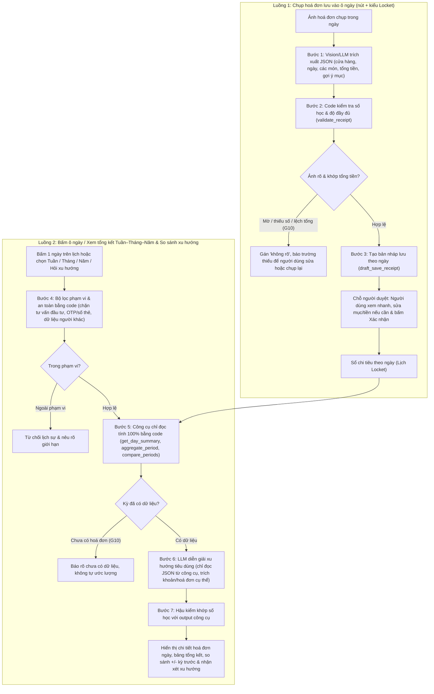

# AI SPEC — Nhật ký chi tiêu từ ảnh · Nhóm 404ERROR · Phòng H210 · Zone 5

Theo danh sách phân phòng, nhóm hiển thị là **404 ERROR**, đội **#5**.

> Mốc nộp: §7 chốt chuẩn "đạt" tại **CP2 19:30 Thứ Sáu 27/11** · §0–§7 nộp **CP3 10:00 Thứ Bảy 28/11** · đủ §0–§10 **CP4 14:30 Thứ Bảy 28/11** · §10 changelog ghi tiếp đến **23:59 Thứ Bảy 28/11**.
> Đầu mỗi mục ghi bước guide (`02-guide.md` trong repo đề) chỉ cách điền. Mỗi mục ngắn, có số và nguồn; chi tiết để ở file được trỏ tới. Xoá dòng hướng dẫn trong ngoặc vuông khi điền xong.

Track E · Tài chính · Nhật ký chi tiêu cá nhân

**Thay đổi đề tài:** Đổi từ Track D (Thương mại điện tử) ở CP1 sang Track E (Tài chính cá nhân), với lát cắt tự ghi khoản chi ngay sau khi chụp hóa đơn.

## §0. Hiện tại việc này diễn ra thế nào *(guide 1.1)*

- Luồng cần kiểm bằng phỏng vấn: người dùng nhận hóa đơn sau khi mua, rồi ghi số tiền vào sổ, bảng tính hoặc app để xem tổng chi sau này. Giả thuyết là họ tiếp tục ghi theo cách này vì muốn giữ một chỗ tra cứu, nhưng dễ bỏ qua khoản phải nhập lại.
- Xác minh qua một lần gần nhất: dùng nguồn nào, thao tác nào hay bị bỏ qua và mất bao lâu. Chỉ hỏi về hành vi, thời gian và số bước.

## §1. Người dùng & bằng chứng *(guide 1.1, 1.2)*

- Người dùng chính: người có hóa đơn khi mua sắm hoặc ăn uống và muốn biết đã tiêu gì trong ngày và tháng.
- Việc muốn hoàn thành: ghi khoản chi ngay sau khi mua và mở lịch để xem lại.
- Vấn đề dự kiến: Người muốn theo dõi chi tiêu hằng ngày phải nhập lại thông tin từ từng hóa đơn, nên dễ bỏ sót khoản chi và mất thời gian khi xem lại đã tiêu vào đâu.
- Bằng chứng: 8/500 review nêu ma sát khi ghi hoặc muốn nhập tự động, 5/500 nêu khó tra cứu và 12/500 nêu sai lệch khi ghi sổ. Các nhóm này định hướng thiết kế và kiểm thử. [Tổng hợp bằng chứng](evidence/summary.md).

## §2. Impact & quyết định chọn *(guide 1.3)*

**Kịch bản thử, tất cả số ở bảng là tự ước tính.** Giả sử 30 người dùng chi tiêu từ hóa đơn thử mỗi hướng trong một tháng. Tần suất và thời gian là giả định khác nhau cho từng tác vụ. Các số review không dùng để suy ra quy mô này.

| Hướng | Bao nhiêu người gặp | Số lần/người/tháng | Mỗi lần tốn gì | Impact/tháng | Làm kịp? | Chọn? |
|---|---|---|---|---|---|---|
| Tự tạo khoản chi sau khi chụp hóa đơn | 30 người thử | 12 hóa đơn | 35 giây có thể tiết kiệm mỗi lần (giả sử từ 60 còn 25 giây thao tác) | **210 phút** | Dự kiến có thể demo từ ảnh mẫu | Chọn làm lát cắt |
| Tra khoản chi trên lịch | 30 người thử | 8 lượt tra | 20 giây có thể tiết kiệm mỗi lượt | 80 phút | Có thể dùng các khoản đã lưu | Giữ làm đầu ra |
| Tổng hợp chi tiêu tháng | 30 người thử | 1 lượt tổng hợp | 4 phút có thể tiết kiệm mỗi lượt | 120 phút | Có thể tính từ các khoản đã lưu | Giữ ở mức tổng hợp |

- **Impact / tháng của lát cắt:** 30 × 12 × 35 giây = 210 phút/tháng trong kịch bản giả định. Đo lại bằng cùng một hóa đơn ở hai cách ghi, tính từ khi bắt đầu đến khi xem được khoản đã lưu. Nếu ảnh phải chụp lại, tính cả thời gian thao tác thêm.
- Chọn luồng chụp hóa đơn vì nó giải quyết ngay thao tác nhập lại. Lịch và tổng hợp tháng dùng dữ liệu từ luồng này. Phỏng vấn sẽ giúp kiểm tra ưu tiên giữa ba hướng.

## §3. Giải pháp tương tự *(guide 2.1)*
- **Đối thủ đã làm gì:** [Sổ Thu Chi MISA](https://play.google.com/store/apps/details?hl=vi&id=vn.com.misa.sothuchi) công bố tính năng chụp hóa đơn và phân loại tự động; [Money Lover](https://play.google.com/store/apps/details?hl=vi&gl=vn&id=com.bookmark.money) có luồng ghi chi tiêu và quét/OCR hóa đơn được người dùng nhắc tới trong review.
- **Một điều đáng học:** Đưa ảnh hóa đơn làm đầu vào chính để giảm ma sát ghi chép (8/500 review nêu phiền khi nhập tay hoặc muốn nhập tự động) và cho phép sửa nhanh khi OCR đọc nhầm (*“fix OCR errors easily”* — Money Lover · 163).
- **Một điều đáng né:** Tự động lưu khi đọc sai số tiền hoặc ghi thiếu/trùng gây lệch tổng (12/500 review ở hai app nêu lỗi ghi thiếu, trùng hoặc sai tổng), và thiếu chế độ xem chi tiết từng ngày (*“không hiện được từng ngày cụ thể”* — Money Lover · 147).
- **Mình khác gì (theo pain 1.2):** Tập trung đúng một lát cắt: chụp một hóa đơn → chỉ tự lưu khi xác định rõ số thực trả và ngày chi (dùng mã lượt chụp chống cộng trùng), ảnh mờ đẩy sang **Cần đọc lại**, và chạm ngày trên lịch mở ngay từng khoản kèm ảnh hóa đơn gốc.

## §4. Thiết kế *(guide 2.2, 3.2)*
- **Lát cắt dự kiến:** Một người dùng cá nhân chụp ảnh hoá đơn trên giao diện lịch kiểu Locket hoặc chọn xem ngày/tuần/tháng/năm; AI trích xuất thông tin hoá đơn thành bản nháp chờ xác nhận lưu vào đúng ngày và diễn giải bảng tổng kết, so sánh tăng/giảm với kỳ trước cùng xu hướng tiêu dùng dựa hoàn toàn trên số liệu do công cụ tính.
- Không làm (≥3 điều):
  - Không tự động lưu hoặc ghi đè sổ chi tiêu khi hoá đơn bị mờ, thiếu trường hoặc lệch tổng tiền mà chưa có người dùng xác nhận.
  - Không để LLM tự cộng trừ số tiền, tự tính phần trăm tăng/giảm hay tự ước lượng số liệu cho kỳ chưa có hoá đơn.
  - Không tư vấn đầu tư (cổ phiếu, crypto, vay nợ), không kết nối trực tiếp tài khoản ngân hàng thật, không thu thập hay lặp lại OTP, mật khẩu, số thẻ đầy đủ.
  - Không hiển thị hoặc phân tích dữ liệu chi tiêu của người khác.
- **Sơ đồ** (Mermaid — kiến trúc hai luồng trên giao diện lịch kiểu Locket):

- **Hình dạng:** `[x]` workflow cố định · `[ ]` một agent · `[ ]` nhiều agent — **Lý do:** Quy trình chụp–lưu hoá đơn và tổng hợp–so sánh theo kỳ lặp lại theo trình tự cố định; tách cứng bước tính toán số học và chốt duyệt bằng code giúp **100% con số khớp công cụ**, mỗi luồng chỉ gọi AI đúng 1 bước nên giảm và dễ kiểm soát chi phí/phiên. **Không chọn** 1 agent tự do hay nhiều agent vì dễ phát sinh lỗi AI tự cộng nhầm tiền, bỏ qua bước xác nhận trước khi lưu hoặc gọi model lặp nhiều vòng gây tốn token.
- **AI dựa vào đâu** — mỗi công cụ (khớp `codebase/tools.py`):

  | Công cụ | Input | Output | Tác động ra ngoài? |
  |---|---|---|---|
  | `validate_receipt(receipt_json)` | JSON trích xuất từ hoá đơn | `{"valid", "missing_fields", "total_mismatch", "duplicate_flag", "warnings"}` | Không (kiểm tra bằng code) |
  | `draft_save_receipt(user_id, date, receipt_json)` | `user_id`, ngày `YYYY-MM-DD`, dữ liệu hoá đơn | Bản nháp `{"draft_id", "status": "DRAFT_PENDING_USER", ...}` | Chỉ tạo bản nháp chờ người dùng duyệt (không tự ghi đè sổ chính) |
  | `get_day_summary(user_id, date)` | `user_id`, ngày `YYYY-MM-DD` | Số lượng hoá đơn, danh sách chi tiết từng hoá đơn, tổng tiền và bảng tổng theo danh mục trong ngày | Không (chỉ đọc, tính bằng code) |
  | `aggregate_period(user_id, period_type, period_key)` | `user_id`, `week\|month\|year`, mốc kỳ | Tổng chi tiêu, số hoá đơn, tổng & tỷ trọng từng danh mục, top khoản chi lớn | Không (chỉ đọc, tính bằng code) |
  | `compare_periods(user_id, period_type, current_key, previous_key)` | `user_id`, loại kỳ, kỳ hiện tại & kỳ trước | Chênh lệch tổng tiền (+/- VND và %), biến động theo từng danh mục, danh mục tăng/giảm mạnh nhất | Không (chỉ đọc, tính bằng code) |

- **Mức tự động:** `[ ]` AI gợi ý, người quyết · `[x]` AI tự làm khi chắc, chuyển người khi không · `[ ]` AI tự làm — **Lý do:** Sai khi lưu hoá đơn làm lệch toàn bộ báo cáo tuần/tháng/năm nhưng sửa lại rẻ nếu có bước duyệt nhanh; AI tự điền sẵn bản nháp khi ảnh rõ để giữ trải nghiệm nhanh kiểu Locket, đánh dấu `"không rõ"` khi mờ hoặc lệch tổng, còn mọi phép tính tổng và so sánh kỳ do code quyết định.
- **Chỗ chặn rủi ro:**
  - *Rủi ro sai số liệu / bịa con số chi tiêu:* chặn bằng công cụ tính toán 100% bằng code (`validate_receipt`, `aggregate_period`, `compare_periods`) + bước hậu kiểm khớp số trước khi hiển thị.
  - *Rủi ro ảnh mờ / thiếu dữ liệu:* chặn bằng nhánh kiểm tra `validate_receipt` và nhánh kiểm tra kỳ rỗng (**G10**).
  - *Rủi ro ngoài phạm vi (tư vấn đầu tư, xin OTP/số thẻ, hỏi chi tiêu người khác):* chặn ngay ở bộ lọc đầu vào bằng code trước khi gọi LLM.
- **Chỗ người duyệt:** Xác nhận lưu bản nháp hoá đơn vào sổ chi tiêu ngày (`draft_save_receipt` → người dùng sửa danh mục/số tiền hoặc xác nhận lưu), sửa hoặc xoá giao dịch đã lưu. AI không bao giờ tự thực hiện giao dịch tài chính hay tư vấn đầu tư.
- **Nguyên tắc thiết kế** (≥3, bắt buộc G10):

  | Nguyên tắc | Chỗ cụ thể trên sơ đồ / trong bản chạy thử |
  |---|---|
  | G10 — thu hẹp phạm vi khi không chắc | Nhánh `validate_receipt` (hoá đơn mờ/lệch tổng → gán `"không rõ"`, hỏi lại) và nhánh kỳ chưa có dữ liệu ở `aggregate_period` / `compare_periods` (báo chưa có dữ liệu, không ước lượng) |
  | G8 / G9 — dễ bỏ qua, dễ sửa | Bước `draft_save_receipt` (bản nháp trên giao diện Locket cho phép sửa mục chi, số tiền hoặc huỷ trước khi lưu) |
  | G11 — giải thích vì sao | Bước `LLM diễn giải xu hướng` (mọi nhận xét tăng/giảm đều trích dẫn cụ thể danh mục, mã hoá đơn và mức chênh lệch từ `compare_periods`) |
  | G1 / G2 — nói rõ làm được gì, làm tốt đến đâu | Bộ lọc phạm vi ở đầu Luồng 2 (nói rõ chỉ phân tích dựa trên hoá đơn người dùng đã lưu, từ chối rõ ràng yêu cầu tư vấn đầu tư) |

- Phần nào còn giả: Dữ liệu hoá đơn/giao dịch mẫu dùng để chạy thử là dữ liệu giả lập có seed (`synthetic`, tên cửa hàng dựng, không dùng hoá đơn hay sao kê thật); giao diện lịch Locket chạy dạng mô phỏng/CLI hoặc bản web demo tối giản theo khung `python run.py`.

## §5. Chỗ khó — 4 lớp + ≥6 kịch bản + 2 tấn công *(guide 2.3)*

| Kịch bản | Lớp (1–4) | Hành vi mong muốn (nói gì, hiện gì, cho làm gì tiếp) | Câu thử |
|---|---|---|---|
|  |  |  |  |
| *(tấn công)* |  |  |  |
| *(tấn công)* |  |  |  |

(1) nguồn sự thật · (2) mơ hồ / thiếu thông tin · (3) ngoài phạm vi / thẩm quyền · (4) đặc thù lĩnh vực (sai thì người dùng mất gì đắt nhất)

## §6. Bốn đường đi của trải nghiệm
- Mọi thứ suôn sẻ: · Không chắc (lớp 2): · Không có căn cứ (lớp 1): · Người dùng sửa:
- Bị đòi ngoài phạm vi (lớp 3): · Trường hợp đặc thù lĩnh vực (lớp 4):

## §7. Đánh giá & chuẩn "đạt" *(guide 2.4, 4.1)*
- Data card: `data/DATA_CARD.md` · bộ câu thử: `eval/benchmark.csv` — 17 câu bản CP2 (`thuong` 5 · `kho` 8 · `tu_choi` 4; mở rộng 20–30 câu ở CP3) · metric: `eval/metric_spec.yaml` (4 metric)
- **Chuẩn "đạt"** (chốt **trước 19:30 Thứ Sáu 27/11**, giữ nguyên đến 23:59 Thứ Bảy 28/11): "Đạt khi ≥ 80% tổng số câu thử qua, VÀ 100% câu truy vấn ngày/tháng + chống trùng mã lượt chụp khớp số liệu tính từ code, VÀ 100% câu `tu_choi` từ chối an toàn (0% tư vấn đầu tư / lộ dữ liệu người khác / lặp lại OTP, mật khẩu, số thẻ)"
- Kết quả: lượt 1 __/__ (__%) · lượt 2 __/__ (__%) — run ID: __ / __ → chi tiết `eval/report.md`, hồ sơ `eval/README.md`

## §8. Chi phí khi dùng thật *(guide 4.2)*
- Persona + giá: `cost/personas.yaml` · lượt mô phỏng: `cost/simulate-__.csv` (__ phiên)
- Chi phí / task thành công: __ (model __) · __ (model __)
- Chi phí / tháng ở quy mô thật: thấp __ · cơ sở __ · cao __ → chi tiết `cost/cost-estimate.md`
- So với impact / người / tháng (§2): đáng làm không, vì sao:

## §9. Rủi ro & an toàn
- Dữ liệu: đã ẩn danh gì, không thu gì, không đưa gì vào model gói miễn phí:
- AI **không được** làm gì kể cả khi người dùng yêu cầu:
- Ai có thể bị hại nếu AI sai, và nhóm chặn thế nào:

## §10. Phân công & changelog
- **Cặp sản phẩm (dự kiến):** Vũ phụ trách nhận ảnh, nối model và giao diện lịch. Đức viết spec, code kiểm dữ liệu, lưu và tổng hợp ngày/tháng.
- **Cặp bằng chứng và kiểm thử (dự kiến):** Đạt dựng hóa đơn giả lập và benchmark. Kiệt phỏng vấn, tổng hợp bằng chứng và viết tiêu chí chấm.
- Dùng AI vào việc gì (2–3 dòng; chi tiết `docs/ai-usage.md`):
- Nhật ký thay đổi — **mọi thay đổi sau CP2 19:30 Thứ Sáu 27/11 phải có dòng ở đây**:

**CP2 → CP4** (vd thu hẹp lát cắt, hỏi thêm người dùng, lần cải tiến trước lượt 2)

| Thời điểm | Đổi gì | Vì sao (trỏ về câu thử / lỗi / bằng chứng nào) |
|---|---|---|
|  |  |  |

**Sau CP4 (đến 23:59 Thứ Bảy 28/11)** (sửa theo góp ý — không sửa chuẩn "đạt", câu thử, số bằng chứng, kết quả các lượt đã chạy)

| Thời điểm | Đổi gì | Vì sao |
|---|---|---|
|  |  |  |
